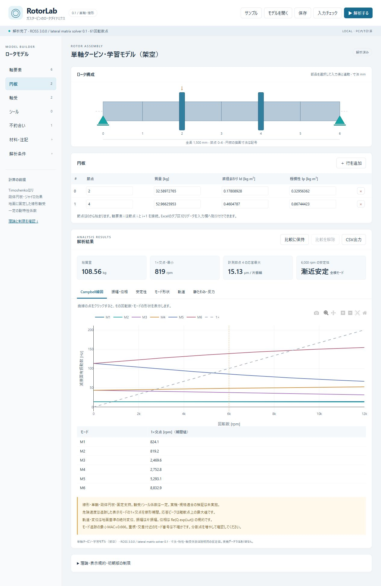

# RotorLab 0.4 — 単軸ロータダイナミクス

ガスタービン関連の単軸ロータについて、形状と軸受係数を変更し、横振動の特性を調べる日本語の初期版です。ROSS 3.0.0の要素行列を使った実際の線形計算です。付属モデルの入力値は架空で、実機の測定値ではありません。

## 0.4の材料一覧と要素への割当

1. 左側の「材料一覧・注記」を開き、「＋ 材料を追加」を押します。既定材料の物性を初期値として複製するので、材料名・密度・E・G・出典を編集してください。これは材料規格データベースではなく、プロジェクト内の材料登録です。
2. 「軸要素」を開き、各行の「材料」プルダウンから登録した材料を選びます。同じ材料を複数の要素に割り当てられます。
3. 材料一覧で物性を変更すると、その材料を選んだ全要素に反映されます。計算済み結果は再解析が必要になります。

材料の名前を変更しても割当は維持されます。「既定」を選んだ要素は材料画面の「既定材料」に従い、材料を明示的に選んだ要素は既定材料を変更しても維持されます。材料一覧には適用要素数を表示し、既定材料と使用中の材料は削除できません。削除する場合は先に要素の選択と既定材料を変更してください。

材料一覧と要素の割当はモデルJSONに保存します。旧schema_version=1/2は、共通材料を既定材料へ、個別材料を名前付きの材料へ自動移行します。新しい保存形式はschema_version=3で、旧版アプリでは読めません。移行後の物性値は保持されます。

軸要素表の貼り付け列は、長さ・左外径・左内径・右外径・右内径・材料名（またはID）の順です。材料列の空欄または「既定」は既定材料となります。未登録の材料は拒否し、その貼り付けによる変更を取り消します。材料物性は材料画面で編集します。従来の軸表の密度・E・G列を含む貼り付け形式とは異なります。

[2種類の材料を使う架空サンプル](examples/material-registry.json)では、軸要素0と3に仮定材B、他の要素に既定の仮定材Aを使います。材料は最大1,024件です。

## 0.3の容量設定（2026-11-17更新）

| 項目 | 旧上限 | 新上限 |
|---|---:|---:|
| 軸要素 | 24 | 512 |
| 円板・軸受・シール・不釣合い（各種類） | 40 | 40 |
| 回転数走査点 | 121 | 1,001 |
| 表示モード | 12 | 32 |
| 一括計算ケース | 32 | 256 |
| 一括パラメータ行 | 8 | 32 |
| モデル / API要求サイズ | 300 KB | 8 MiB |

入力表の追加・貼り付け、JSON読込、サーバー検証は共通の `limits.json` を参照します。設定を編集した場合はサーバーを再起動して画面を更新してください。物性・寸法・係数の妥当性チェックは継続します。

全横モードの固有値計算は継続し、質量行列の分解を再利用します。同期応答は隣接節点の帯行列を直接解き、元の全行列で残差を確認します。一括計算は各ケースを順に生成し、比較に必要な曲線と変更値を保持します。ケースの詳細なモード情報は「モデルへ反映」後に通常解析で取得できます。

大きいモデルでは初回に確認回転数のモード形状を保存し、他の回転数は選択時に追加計算します。Campbell図で追跡した固有値と照合し、選択した回転数の形状を表示します。重根では形状の基底が変わることがあります。取得履歴も容量に応じて解放します。

上限は同時に最大設定での即時応答を保証する値ではありません。全固有値を各回転数で計算するため、要素数・走査点数・ケース数の積で時間が増えます。まず少ない点数・ケース数で確認してから増やしてください。測定例は [VERIFICATION.md](VERIFICATION.md) に記載しています。

100要素の試験モデル: [rotor-100-elements.json](examples/rotor-100-elements.json)。画面の「モデルを開く」で読み込めます。6要素サンプルの全長・円板位置・軸受位置を維持して細分割し、21点・12モードで解析します。512要素は入力上限であり、今回の実計算確認は100要素です。

## 0.2の追加機能

- **テーパー軸**: 軸要素の左/右端の内径・外径を別々に設定。左右同径なら円筒軸です。
- **要素別の材料**: 材料画面に登録し、軸要素ごとに選択します。0.4で材料一覧方式へ移行しました。
- **指数表示**: 入力表上の「数値表示」で通常/指数を切替。`1.5E6`、`2D-3`の入力と貼り付けに対応。表示は7桁の有効数字ですが、フォーカス時には元の数値の全精度を表示し、表示切替で保存値は丸めません。節点・点数・モード数は整数表示です。
- **軸受剛性の一括計算**: 軸受番号・成分・候補値をパラメータ表に追加して「一括計算する」。結果を一覧・グラフ・CSVで比較できます。

一括計算の例: 軸受0のkxx+kyyに `5E5, 1E6`、軸受1のkxx+kyyに `1E6, 2E6` を指定すると「全組合せ」は4ケース。「同じ順番」は2ケースです。1個だけの候補値は全ケースで共通となります。同じ軸受・成分の重複指定は拒否します。候補は倍率ではなく絶対剛性 [N/m] で、減衰係数は変えません。最大32行・256ケースです。

グラフは不釣合い応答、表示モード内の最低固有振動数、全横モードの最大実部を選択できます。応答は `max(|X|, |Y|)` の片振幅です。失敗ケースはエラーとして一覧に残し、グラフには含めません。「モデルへ反映」したケースを通常解析すると、モード形状などを確認できます。候補値と組合せ設定もモデルJSONに保存されます。

追加例は [テーパー・個別材料・2軸受の4ケース比較](examples/taper-material-sweep.json)。架空の入力です。「モデルを開く」で選択できます。

## インストールと起動（Windows / Python 3.12・64 bit）

Python 3.12をインストールしたPCで、PowerShellから次を実行します。

```powershell
git clone https://github.com/ai-infra-data-lab/rotorlab.git
cd rotorlab
python -m venv .venv
& '.venv/Scripts/python.exe' -m pip install -r requirements.txt
.\start.bat
```

初回の依存パッケージ取得にはインターネット接続が必要です。Python本体・`.venv`・依存パッケージはリポジトリに含みません。Pythonの導入環境によっては `python` の代わりに `py -3.12` を使用してください。

`start.bat` をダブルクリックします。ブラウザに `http://127.0.0.1:8765` が開きます。初回の計算はライブラリ読込で時間がかかる場合があります。起動ウィンドウを閉じるか Ctrl+C で終了します。

別ポートで起動する場合:

```powershell
# リポジトリのフォルダで実行
& '.venv/Scripts/python.exe' server.py --port 8766
```

依存パッケージは本フォルダ専用の `.venv` に導入します。セットアップ後の通常利用にインターネット接続、外部CDN、アカウント、APIキーは不要です。モデルデータを外部へ送信しません。保存・CSV出力はブラウザのダウンロード先へ出力します。モデル読込はブラウザで選んだJSONだけを処理し、サーバー側にはモデルファイルを保存しません。



## 最初の操作

1. 初期表示の架空サンプルで「解析する」を押します。
2. Campbell線図、振幅・位相、安定性、モード形状、軌道、静たわみ・反力のタブを切り替えます。
3. 左側の「軸受」で `kxx`, `kyy`, `cxx`, `cyy` などを変更して再解析します。
4. 「比較に保持」→条件変更→再解析でCampbellと振幅の重ね合わせを確認できます。比較のモード番号は各ケースで独立であり、別ケース間の同一モード対応は保証しません。
5. 「保存」でモデルをJSON保存し、「モデルを開く」で再利用します。結果はCSV出力できます。

図の軸・円板・軸受を選択すると入力表の該当行を選択します。入力表の数値欄にはExcelのタブ区切りデータを貼り付けできます。列見出しのない数値データを、開始列に合わせて貼り付けてください。

軸要素iは節点iとi+1を結びます。軸の追加・削除後は全ての円板・軸受・シール・不釣合い・計測節点の番号を確認してください。図の円板寸法は記号であり、実径を表しません。円板は質量とId/Ipを直接入力します。

## 計算・単位・解釈

- 軸: Timoshenkoはり、Cowperせん断補正、回転慣性・ジャイロ効果。材料未指定または「既定」の要素は、材料一覧で指定した既定の等方性材料を継承します。材料の物性は各要素内で一定、径は要素内で線形変化します。材料が変わる境界で軸要素を分割してください。
- 円板: 剛体・軸対称。Idは直径まわり、Ipは回転軸まわりの慣性モーメント。
- 軸受・シール: 一定の2×2剛性・減衰行列。支持は地面に固定。
- 自由度: 各節点x, y, alpha, beta。ROSSの6自由度行列から横振動成分だけを抽出。
- 固有値: `Mq̈ + (C + ΩG)q̇ + Kq = 0` の複素固有値。正の実部は不安定、ほぼ0は中立/境界。非振動の実固有値を含むモデルは初期版の対象外としてエラーにします。
- モード追跡: 質量重み付き複素MACと割当法。MAC<0.7は警告。重根・モード交差・粗い回転数分割では追跡番号に注意。
- 不釣合い: `g mm × 1e-6 = kg m`。`q(t)=Re(Q exp(iωt))`、正回転は+z軸まわりx→y。Fx=Uω²exp(iφ)、Fy=−iFx。全横自由度で直接周波数応答を計算。
- 出力変位は地面基準の絶対変位、片振幅µm。軌道は選択した確認回転数の同期振動成分（静たわみを除く）。ゼロ振幅の位相は未定義として空欄。
- 危険速度は表示したモードと1×線の交点を線形補間。応答ピークは走査した離散点上の最大値。1×交点に必ず応答ピークが現れるわけではありません。
- 静解析は重力−Y、シール剛性を重量支持から除外。支持反力は軸受からロータに作用する力。動反力は同期成分の各軸片振幅。
- 不安定域の定常強制応答は代数的な解であり、実際にその振幅で安定運転できることを意味しません。

## 対象範囲と制限

軸要素1～512、円板・軸受・シール・不釣合いは各40件、回転数走査2～1,001点に確認回転数を追加、表示モード1～32（横自由度数まで）。モデルJSON / API要求は8 MiBまで。異なる2節点以上の軸受が必要です。

0.1/0.2/0.3のモデル（schema_version=1/2）は読込時に移行できます。新しい保存形式はschema_version=3で、旧版アプリへの逆互換性はありません。NAS/UNCパスではstart.batがpushdでフォルダを開きます。仮想環境は作成したPCに依存するため、PCを替えた場合はそのPCで再セットアップしてください。既に起動中の旧サーバーがある場合は終了し、再起動してから画面を更新してください。

軸受の油膜計算、周波数依存係数、温度連成、柔軟な支持構造、円板変形、複数軸、ねじり・軸振動、接触・非線形、起動停止、規格の合否判定は未実装です。実機の設計判断に使う前に、入力係数の妥当性、要素分割・回転数分割の収束、メーカー計算や測定との照合が必要です。

## 再セットアップ・テスト

Python 3.12（64 bit）とpipのある環境で:

```powershell
powershell -ExecutionPolicy Bypass -File .\setup.ps1 -Python 'C:\path\to\python.exe'
& '.venv/Scripts/python.exe' -m unittest -v
```

Node.jsがある環境で画面ロジックの追加チェックを行う場合:

```powershell
& '.venv/Scripts/python.exe' tools/generate_sample_result.py
node --check static/app.js
node verify_ui_logic.cjs
```

このロジックチェックは実ブラウザでの表示・操作確認の代わりにはなりません。

`ExecutionPolicy Bypass`はこのプロセスだけに適用されます。組織PCでは組織の運用規則に従ってください。初回公開時の依存バージョンは `requirements-lock.txt` に記録しています。初期セットアップは `requirements.txt`、初回公開時と同一環境の再現にはlockを使用してください。0.2での検証条件は `VERIFICATION.md` を参照してください。

ROSSが依存するccpの初期化時に、日本語パスやREFPROP未導入に関する警告が出る場合があります。本アプリは流体物性計算・REFPROPを利用せず、横振動の要素行列のみを使います。この警告と解析失敗は区別してください。

検証結果は `VERIFICATION.md` を参照してください。2026-10-22に実ブラウザで解析・各結果タブ・図と表の連動・貼り付け・JSON読込・JSON/CSV保存・条件変更と比較・入力エラー・ズームを確認しました。入力変更後は結果欄にも再解析の警告を表示します。グラフの外部共有ボタンは非表示です。

## 根拠資料とライセンス

- [ROSS 3.0.0](https://github.com/petrobras/ross/releases/tag/v3.0.0) — Apache-2.0。インストールされた配布物にライセンスを含みます。
- [ROSS公式理論・モデル化](https://ross.readthedocs.io/en/v3.0.0/user_guide/tutorial_modeling_part_1.html)
- [ROSS文献検証](https://ross.readthedocs.io/en/stable/validation.html) — Friswell et al. (2010), Example 5.9.1。表に含まれるねじりモードを除いて横振動を比較。
- [Ansys Campbell線図](https://ansyshelp.ansys.com/public/Views/Secured/corp/v242/en/ans_rot/Hlp_G_ROTCAMPDIAGS.html)
- UI方針の参考: [Dyrobes](https://dyrobes.com/features/rotordynamics/)、[ARMD](https://www.rbts.com/ARMDRotorDynamics.html)、[XLRotor](https://www.xlrotor.com/xlrotor/XLRotorDataSheet.pdf)。部品表・図の連動、ケース比較、自動作図を独自実装しています。

ARMDとの理論比較は [比較資料](docs/ARMD_THEORY_COMPARISON.md) にまとめています。参照した第三者のPDF・マニュアル・ZIP・テキスト抽出物は再配布していません。ROSS等の依存ソフトウェアのライセンスは各配布元を参照してください。ROSSを利用していることは、ROSS開発者やARMDメーカーによる本アプリの承認・性能保証を意味しません。
