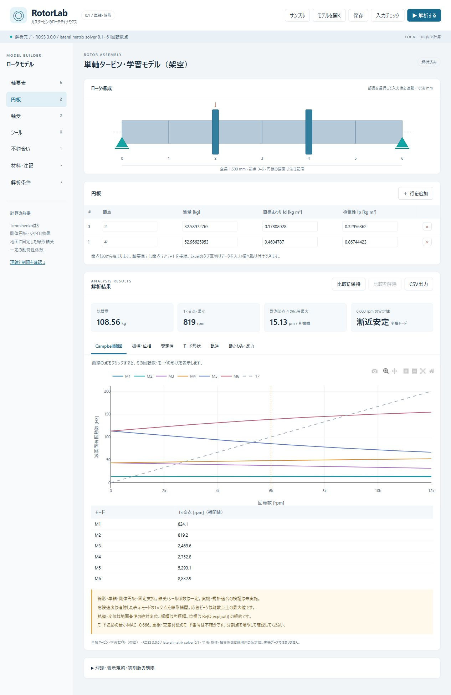

# RotorLab 0.1 — 単軸ロータダイナミクス

ガスタービン関連の単軸ロータについて、形状と軸受係数を変更し、横振動の特性を調べる日本語の初期版です。ROSS 3.0.0の要素行列を使った実際の線形計算です。付属モデルの入力値は架空で、実機の測定値ではありません。

## インストールと起動（Windows / Python 3.12・64 bit）

Python 3.12をインストールしたPCで、PowerShellから次を実行します。

```powershell
git clone https://github.com/ai-infra-data-lab/rotorlab.git
cd rotorlab
python -m venv .venv
& '.venv/Scripts/python.exe' -m pip install -r requirements.txt
.\start.bat
```

初回の依存パッケージ取得にはインターネット接続が必要です。Python本体・`.venv`・依存パッケージはリポジトリに含みません。Pythonの導入環境によっては `python` の代わりに `py -3.12` を使用してください。

`start.bat` をダブルクリックします。ブラウザに `http://127.0.0.1:8765` が開きます。初回の計算はライブラリ読込で時間がかかる場合があります。起動ウィンドウを閉じるか Ctrl+C で終了します。

別ポートで起動する場合:

```powershell
# リポジトリのフォルダで実行
& '.venv/Scripts/python.exe' server.py --port 8766
```

依存パッケージは本フォルダ専用の `.venv` に導入します。セットアップ後の通常利用にインターネット接続、外部CDN、アカウント、APIキーは不要です。モデルデータを外部へ送信しません。保存・CSV出力はブラウザのダウンロード先へ出力します。モデル読込はブラウザで選んだJSONだけを処理し、サーバー側にはモデルファイルを保存しません。



## 最初の操作

1. 初期表示の架空サンプルで「解析する」を押します。
2. Campbell線図、振幅・位相、安定性、モード形状、軌道、静たわみ・反力のタブを切り替えます。
3. 左側の「軸受」で `kxx`, `kyy`, `cxx`, `cyy` などを変更して再解析します。
4. 「比較に保持」→条件変更→再解析でCampbellと振幅の重ね合わせを確認できます。比較のモード番号は各ケースで独立であり、別ケース間の同一モード対応は保証しません。
5. 「保存」でモデルをJSON保存し、「モデルを開く」で再利用します。結果はCSV出力できます。

図の軸・円板・軸受を選択すると入力表の該当行を選択します。入力表の数値欄にはExcelのタブ区切りデータを貼り付けできます。列見出しのない数値データを、開始列に合わせて貼り付けてください。

軸要素iは節点iとi+1を結びます。軸の追加・削除後は全ての円板・軸受・シール・不釣合い・計測節点の番号を確認してください。図の円板寸法は記号であり、実径を表しません。円板は質量とId/Ipを直接入力します。

## 計算・単位・解釈

- 軸: Timoshenkoはり、Cowperせん断補正、回転慣性・ジャイロ効果。材料は全軸共通の等方性、一定値。
- 円板: 剛体・軸対称。Idは直径まわり、Ipは回転軸まわりの慣性モーメント。
- 軸受・シール: 一定の2×2剛性・減衰行列。支持は地面に固定。
- 自由度: 各節点x, y, alpha, beta。ROSSの6自由度行列から横振動成分だけを抽出。
- 固有値: `Mq̈ + (C + ΩG)q̇ + Kq = 0` の複素固有値。正の実部は不安定、ほぼ0は中立/境界。非振動の実固有値を含むモデルは初期版の対象外としてエラーにします。
- モード追跡: 質量重み付き複素MACと割当法。MAC<0.7は警告。重根・モード交差・粗い回転数分割では追跡番号に注意。
- 不釣合い: `g mm × 1e-6 = kg m`。`q(t)=Re(Q exp(iωt))`、正回転は+z軸まわりx→y。Fx=Uω²exp(iφ)、Fy=−iFx。全横自由度で直接周波数応答を計算。
- 出力変位は地面基準の絶対変位、片振幅µm。軌道は選択した確認回転数の同期振動成分（静たわみを除く）。ゼロ振幅の位相は未定義として空欄。
- 危険速度は表示したモードと1×線の交点を線形補間。応答ピークは走査した離散点上の最大値。1×交点に必ず応答ピークが現れるわけではありません。
- 静解析は重力−Y、シール剛性を重量支持から除外。支持反力は軸受からロータに作用する力。動反力は同期成分の各軸片振幅。
- 不安定域の定常強制応答は代数的な解であり、実際にその振幅で安定運転できることを意味しません。

## 対象範囲と制限

軸要素1～24、各部品最大40、回転数走査11～121点に確認回転数を追加、表示モード2～12。異なる2節点以上の軸受が必要です。

軸受の油膜計算、周波数依存係数、温度連成、柔軟な支持構造、円板変形、複数軸、ねじり・軸振動、接触・非線形、起動停止、規格の合否判定は未実装です。実機の設計判断に使う前に、入力係数の妥当性、要素分割・回転数分割の収束、メーカー計算や測定との照合が必要です。

## 再セットアップ・テスト

Python 3.12（64 bit）とpipのある環境で:

```powershell
powershell -ExecutionPolicy Bypass -File .\setup.ps1 -Python 'C:\path\to\python.exe'
& '.venv/Scripts/python.exe' -m unittest -v
```

Node.jsがある環境で画面ロジックの追加チェックを行う場合:

```powershell
& '.venv/Scripts/python.exe' tools/generate_sample_result.py
node --check static/app.js
node verify_ui_logic.cjs
```

このロジックチェックは実ブラウザでの表示・操作確認の代わりにはなりません。

`ExecutionPolicy Bypass`はこのプロセスだけに適用されます。組織PCでは組織の運用規則に従ってください。現在の環境の全依存バージョンは `requirements-lock.txt` に記録しています。初期セットアップは `requirements.txt`、同一環境の再現にはlockを使用してください。

ROSSが依存するccpの初期化時に、日本語パスやREFPROP未導入に関する警告が出る場合があります。本アプリは流体物性計算・REFPROPを利用せず、横振動の要素行列のみを使います。この警告と解析失敗は区別してください。

検証結果は `VERIFICATION.md` を参照してください。2026-10-22に実ブラウザで解析・各結果タブ・図と表の連動・貼り付け・JSON読込・JSON/CSV保存・条件変更と比較・入力エラー・ズームを確認しました。入力変更後は結果欄にも再解析の警告を表示します。グラフの外部共有ボタンは非表示です。

## 根拠資料とライセンス

- [ROSS 3.0.0](https://github.com/petrobras/ross/releases/tag/v3.0.0) — Apache-2.0。インストールされた配布物にライセンスを含みます。
- [ROSS公式理論・モデル化](https://ross.readthedocs.io/en/v3.0.0/user_guide/tutorial_modeling_part_1.html)
- [ROSS文献検証](https://ross.readthedocs.io/en/stable/validation.html) — Friswell et al. (2010), Example 5.9.1。表に含まれるねじりモードを除いて横振動を比較。
- [Ansys Campbell線図](https://ansyshelp.ansys.com/public/Views/Secured/corp/v242/en/ans_rot/Hlp_G_ROTCAMPDIAGS.html)
- UI方針の参考: [Dyrobes](https://dyrobes.com/features/rotordynamics/)、[ARMD](https://www.rbts.com/ARMDRotorDynamics.html)、[XLRotor](https://www.xlrotor.com/xlrotor/XLRotorDataSheet.pdf)。部品表・図の連動、ケース比較、自動作図を独自実装しています。

ARMDとの理論比較は [比較資料](docs/ARMD_THEORY_COMPARISON.md) にまとめています。参照した第三者のPDF・マニュアル・ZIP・テキスト抽出物は再配布していません。ROSS等の依存ソフトウェアのライセンスは各配布元を参照してください。ROSSを利用していることは、ROSS開発者やARMDメーカーによる本アプリの承認・性能保証を意味しません。
